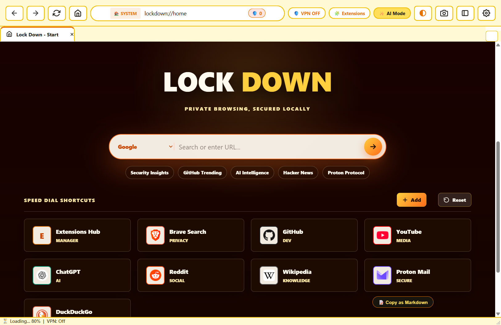
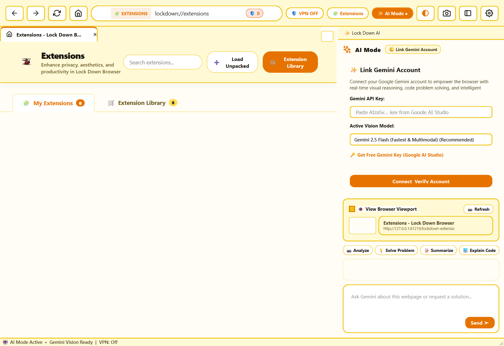
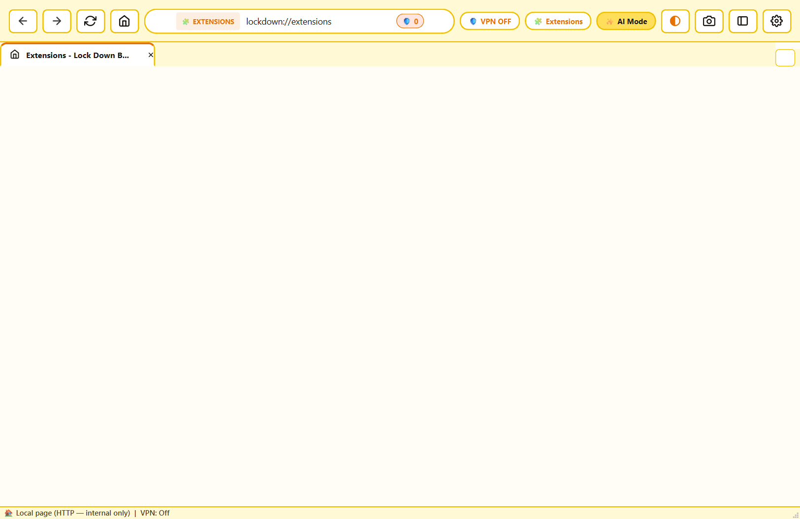
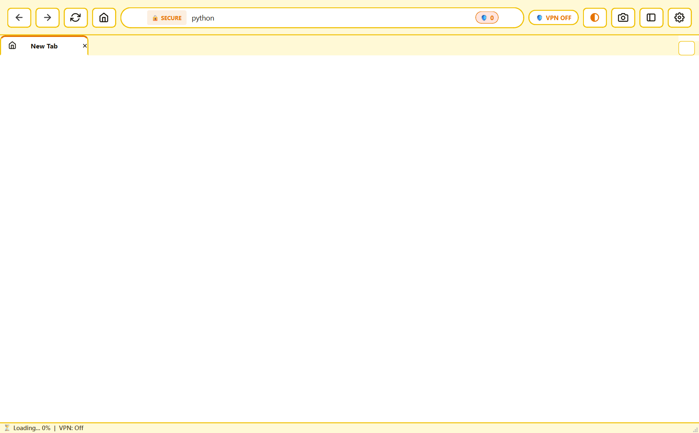
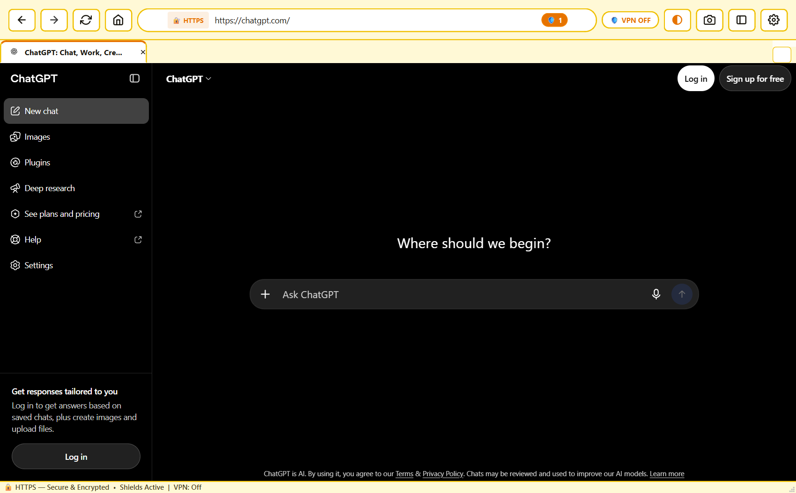
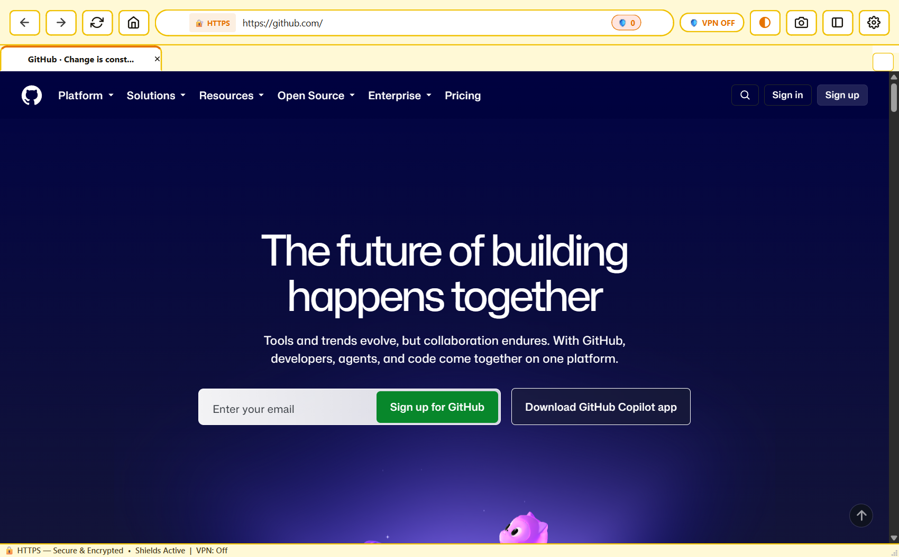

<div align="center">


# 🔒 Lock Down Browser

**A fast, private, and intelligent browser built with Python & PyQt6**

[](https://github.com/ankushkundapuraannaiah-bit/LockDown/releases/latest)
[](https://github.com/ankushkundapuraannaiah-bit/LockDown/releases/latest)
[](https://www.python.org/)
[](LICENSE.txt)
[](https://github.com/ankushkundapuraannaiah-bit/LockDown/stargazers)

<br/>

[⬇️ **Download Installer (.exe)**](https://github.com/ankushkundapuraannaiah-bit/LockDown/releases/latest/download/LockDownBrowser-Setup.exe) &nbsp;|&nbsp; [📖 Docs](#-getting-started) &nbsp;|&nbsp; [🐛 Issues](https://github.com/ankushkundapuraannaiah-bit/LockDown/issues)

</div>

---

## ✨ Features

| Feature | Description |
|---|---|
| 🛡️ **Privacy First** | Built-in ad blocker, tracker blocker, and no telemetry whatsoever |
| 🤖 **Gemini AI Mode** | Integrated Google Gemini AI — ask questions, summarize pages, get help while you browse |
| 🔌 **Extensions** | Install and manage browser extensions from an in-browser library |
| ⬇️ **Download Manager** | Full-featured downloads panel with progress tracking, pause/resume, and history |
| 🔒 **Crypto Vault** | Encrypted local password/notes vault — your data never leaves your machine |
| 🌐 **VPN Service** | Built-in VPN toggle for anonymous browsing |
| ⚙️ **Settings** | Dedicated settings page for appearance, search engine, privacy, and more |
| 🧘 **Zen Mode** | Distraction-free fullscreen browsing |
| 🕰️ **History Manager** | Full browsing history with search and delete |
| 🌙 **Dark / Light Theme** | Instant theme switching with a beautiful animated homepage |

---

## 📸 Screenshots

<div align="center">

| Homepage | AI Mode | Extensions |
|---|---|---|
|  |  |  |

| Omnibox | Search | GitHub |
|---|---|---|
|  |  |  |

</div>

---

## ⬇️ Getting Started

### Option 1 — Download the Installer (Recommended)

> **Windows 10 / 11 (64-bit) only**

1. Click **[⬇️ Download LockDownBrowser-Setup.exe](https://github.com/ankushkundapuraannaiah-bit/LockDown/releases/latest/download/LockDownBrowser-Setup.exe)**
2. Run the installer and follow the steps
3. Launch **Lock Down Browser** from your Desktop or Start Menu

---

### Option 2 — Run from Source

```bash
# 1. Clone the repository
git clone https://github.com/ankushkundapuraannaiah-bit/LockDown.git
cd LockDown

# 2. Install dependencies
pip install -r requirements.txt

# 3. Launch the browser
python browser.py
```

**Or on Windows, double-click `run_browser.bat`.**

#### Requirements (source)
- Windows 10 / 11 (64-bit)
- Python 3.11 or higher
- pip packages listed in `requirements.txt`

---

## 🤖 AI Mode — Powered by Google Gemini

Lock Down Browser integrates Google Gemini AI directly into your browsing session.

1. Click the **✨ AI** button in the toolbar
2. Connect your Gemini account
3. Ask anything — Gemini can see what you're browsing and help you

---

## 🔌 Extensions

Browse and install extensions from the built-in library:

1. Click the **🔌 Extensions** button in the toolbar
2. Go to the **Library** tab to discover new extensions
3. Click **Install** — done!

---

## 🏗️ Build from Source (EXE)

```bash
# Install PyInstaller
pip install pyinstaller

# Build the distributable
python -m PyInstaller LockDownBrowser.spec

# Output: dist/LockDownBrowser/LockDownBrowser.exe
```

To build a professional installer, install [Inno Setup](https://jrsoftware.org/isinfo.php) and run:

```
ISCC.exe setup.iss
# Output: Output/LockDownBrowser-Setup.exe
```

---

## 🤝 Contributing

Contributions are welcome! Please:

1. Fork the repository
2. Create a feature branch (`git checkout -b feature/amazing-feature`)
3. Commit your changes (`git commit -m 'feat: add amazing feature'`)
4. Push to the branch (`git push origin feature/amazing-feature`)
5. Open a Pull Request

---

## 🔒 Privacy

Lock Down Browser is designed with privacy as a core principle:

- ✅ No telemetry or usage tracking
- ✅ No accounts required (AI mode is opt-in with your own Gemini key)
- ✅ Crypto Vault data is encrypted and stored **locally only**
- ✅ Ad/tracker blocking enabled by default
- ✅ Open source — audit the code yourself

---

## 📄 License

This project is licensed under the **MIT License** — see [LICENSE.txt](LICENSE.txt) for details.

---

<div align="center">

Made with ❤️ by [Ankush Kundapura Annaiah](https://github.com/ankushkundapuraannaiah-bit)

⭐ **Star this repo if you find it useful!** ⭐

</div>
